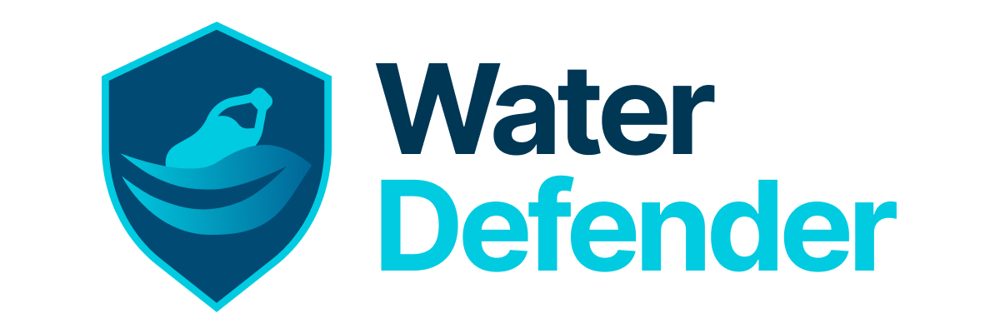
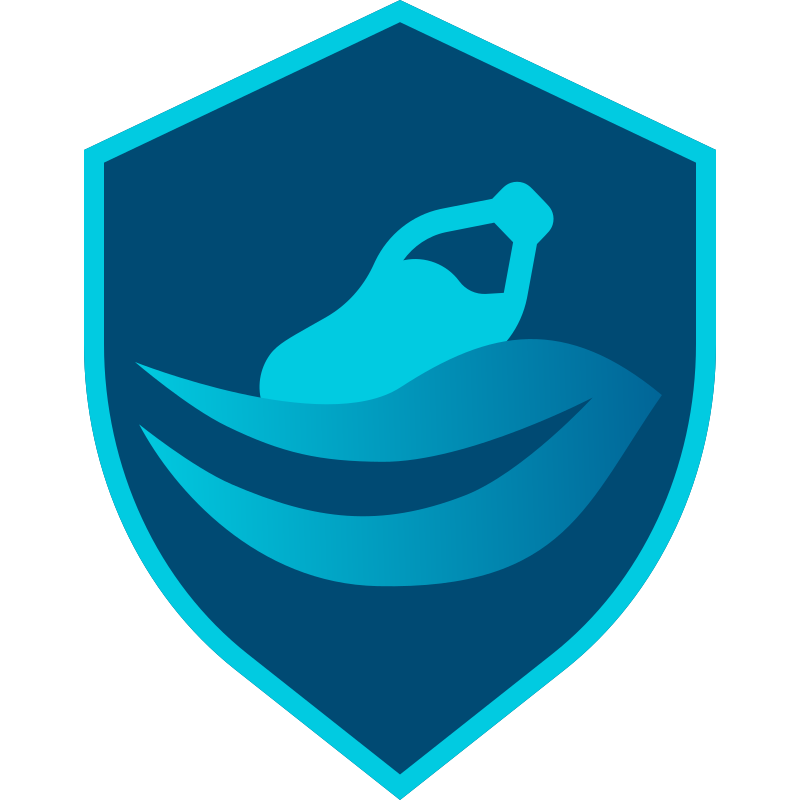

<div align="center">

  

  

  <br />

  

  <br />


[Getting Started](#getting-started) ·
[Development](#development) ·
[Project Structure](#project-structure) ·
[Contributing](#contributing)

</div>

---

## About

WaterDefender is a Laravel-based web application developed as part
of the TLE2 project, combining reactive interfaces, modern frontend
tooling and automated code quality checks.

> [!NOTE]
> The project is currently under active development.
> Core WaterDefender functionality has yet to be implemented.

## Technology Stack

| Layer         | Technologies                              |
| :------------ | :---------------------------------------- |
| Backend       | PHP 8.3+, Laravel 13                      |
| Frontend      | Blade, Livewire 4, Blaze                  |
| Styling       | Tailwind CSS 4                            |
| Build tooling | Vite+, Node.js, npm                       |
| Database      | SQLite                                    |
| Testing       | Pest 5                                    |
| Code quality  | Larastan, PHPStan, Laravel Pint, Prettier |

## Getting Started

### Requirements

- PHP 8.3+
- Composer
- Node.js 26.13.1
- npm 12.2.3

Node.js and npm versions are managed through Volta.

### Installation

```bash
git clone https://github.com/toon-van-berkel/WaterDefender.git
cd WaterDefender
composer run setup
```

The setup script installs dependencies, configures the environment,
generates the application key, runs migrations and builds frontend assets.

### Run locally

```bash
composer run dev
```

Open [localhost:8000](http://localhost:8000) in your browser.

<details>
<summary><b>Manual installation</b></summary>

<br />

```bash
composer install
cp .env.example .env
php artisan key:generate
php artisan migrate
npm install
npm run build
```

For Windows PowerShell:

```powershell
Copy-Item .env.example .env
```

</details>

## Development

### Available Commands

| Command                    | Description                           |
| :------------------------- | :------------------------------------ |
| `composer run setup`       | Initialize the application            |
| `composer run dev`         | Start the development environment     |
| `composer run test`        | Run the complete quality check suite  |
| `composer run lint`        | Format PHP code                       |
| `composer run lint:check`  | Validate code formatting              |
| `composer run types:check` | Run static analysis                   |
| `composer run ci:check`    | Run CI checks                         |
| `npm run dev`              | Start the frontend development server |
| `npm run build`            | Build production assets               |
| `npm run format`           | Format frontend code using Prettier   |

### Quality Control

Every contribution should pass the complete quality check suite.

```bash
composer run test
```


Individual checks can also be executed independently.

```bash
composer run lint:check
composer run types:check
php artisan test
```

### Code Formatting

WaterDefender uses automated code formatting to maintain a consistent
code style across the application.

| Formatter    | Responsibility           | Command             |
| :----------- | :----------------------- | :------------------ |
| Laravel Pint | PHP code formatting      | `composer run lint` |
| Prettier     | Frontend code formatting | `npm run format`    |

Run both formatters before submitting a pull request:

```bash
composer run lint
npm run format
```

## Project Structure

```text
WaterDefender/
├── app/                 # Application logic
├── bootstrap/           # Framework initialization
├── config/              # Application configuration
├── database/
│   ├── factories/
│   ├── migrations/
│   └── seeders/
├── public/              # Public assets
├── resources/
│   ├── css/
│   ├── js/
│   └── views/
├── routes/              # Application routes
├── tests/
│   ├── Feature/
│   └── Unit/
├── .env.example
├── composer.json
└── package.json
```

## Configuration

Environment-specific configuration is managed through `.env`.

```dotenv
DB_CONNECTION=sqlite

SESSION_DRIVER=database
CACHE_STORE=database
QUEUE_CONNECTION=database
```

> [!IMPORTANT]
> Never commit a populated `.env` file or hardcode sensitive credentials.

When changing the database configuration, run:

```bash
php artisan migrate
```

## Contributing

1. Create a feature or fix branch.
2. Follow the existing Laravel and frontend conventions.
3. Add or update relevant tests.
4. Format PHP code using `composer run lint`.
5. Format frontend code using `npm run format`.
6. Run `composer run test`.
7. Submit a pull request.

## Contributors

<div align="center">

  <a href="https://github.com/toon-van-berkel/WaterDefender/graphs/contributors">
    
  </a>

</div>

---

<div align="center">

  

  <br />

**Designed. Developed. Defended.**

TLE2 · WaterDefender · MIT License

  

</div>
